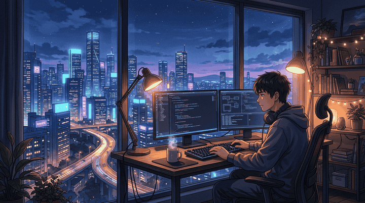

<div align="center">

<!-- 🎬 SCENE 00: THE CINEMATIC ANIMATED BANNER (Boy Coding Overlooking Tech City) -->
<a href="https://khitishkumar.vercel.app/" target="_blank">
  
</a>

<br><br>

# 🎬 ᴋʜɪᴛɪꜱʜ ᴋᴜᴍᴀʀ
### *AI Systems Engineer & Full-Stack Architect • Startup Founder Spirit*

<p>
  <i>"Somewhere between 03:00 AM, glowing monitors, and dark roast coffee — the future is compiled."</i>
</p>

<!-- 🎧 LIVE AUDIO EQUALIZER & SOUNDTRACK HUD -->
<p align="center">
  
  <br>
  <code>▶ 02:47 ━━━━━━━━━━━━━━━━━━━━●────── 04:20 &nbsp; ⇄ &nbsp; ◃◃ &nbsp; ⅠⅠ &nbsp; ▹▹ &nbsp; ↻ &nbsp; 🔊 85%</code>
  <br>
  <sub>🎧 <b>Audio Feed:</b> <i>Lofi Synthwave // Midnight in the High-Rise Studio (Overlooking Neon Horizon)</i></sub>
</p>

<!-- ⚡ DYNAMIC ANIMATED TYPING REEL -->
<a href="https://khitishkumar.vercel.app/">
  
</a>

<br><br>

<!-- 🟢 AESTHETIC TELEMETRY STATUS PILLS -->
<a href="https://github.com/Khitishnayak">
  
</a>
&nbsp;
<a href="https://github.com/Khitishnayak?tab=followers">
  
</a>
&nbsp;
<a href="https://khitishkumar.vercel.app/">
  
</a>
&nbsp;
<a href="https://archlinux.org/">
  
</a>
&nbsp;
<a href="mailto:kknayak049@gmail.com">
  
</a>

<br><br>


</div>

<br>

### 🌆 Scene 01 // The High-Rise Live Console

<div align="center">

<!-- ANIMATED TERMINAL WINDOW -->


</div>

<br>

```text
╭──────────────────────────────────────────────────────────────────────────────╮
│  STATION ZERO // 42ND FLOOR OVERLOOKING SILICON HORIZON                      │
├──────────────────────────────────────────────────────────────────────────────┤
│  🌃 SCENERY     │ Floor-to-ceiling glass window, cyber night, highway trails │
│  👨‍💻 OPERATOR    │ Khitish Kumar Nayak (AI Engineer & Full-Stack Architect)    │
│  ☕ FUEL        │ Steaming dark roast pour-over & relentless obsession       │
│  🐧 WORKSPACE   │ Arch Linux (Rolling) • Hyprland • Neovim • Alacritty       │
│  🧠 DOMAINS     │ Autonomous Multi-Agent AI • WebGL 3D • Distributed APIs    │
│  🏛️ ACADEMY     │ Lovely Professional University (LPU)                       │
│  📍 COORDINATES │ Jalandhar, Punjab, India                                   │
│  🌐 PORTFOLIO   │ https://khitishkumar.vercel.app                            │
│  📫 TRANSMIT    │ kknayak049@gmail.com                                       │
│  ✨ CREED       │ "Software shouldn't just work — it should feel alive."     │
╰──────────────────────────────────────────────────────────────────────────────╯
```

<div align="center">
  
</div>

<br>

### 🎬 Scene 02 // What's On The Screen (The Startup Lab)

- 🔭 **Building the Future**: Architecting autonomous LLM multi-agent systems and real-time neural inference pipelines.
- ⚡ **Startup Velocity**: Shipping high-leverage products from zero-to-one with rapid iteration and zero compromises on design.
- 🎨 **Visual Physics**: Engineering fluid, physics-based interactive web experiences using **Three.js**, **GSAP**, and **React**.
- 🐧 **Custom Workstation**: Daily driving a tuned Arch Linux + Hyprland rice with custom keybindings and Neovim workflows.
- 🤝 **The Open Horizon**: Collaborating with founders, researchers, and fellow builders on audacious ideas.

<div align="center">
  
</div>

<br>

### ⚡ Scene 03 // The Workbench (Tools of Creation)

<div align="center">

#### 🧠 Neural Architectures & Artificial Intelligence
<p align="center">
  <a href="https://skillicons.dev">
    
  </a>
</p>

#### 🎨 Creative Web & Interface Engineering
<p align="center">
  <a href="https://skillicons.dev">
    
  </a>
</p>

#### 🛠️ Distributed Backends, Databases & Cloud
<p align="center">
  <a href="https://skillicons.dev">
    
  </a>
</p>

#### 🐧 Cockpit & Systems Engineering
<p align="center">
  <a href="https://skillicons.dev">
    
  </a>
</p>


</div>

<br>

### 🎞️ Scene 04 // The Featured Works (Filmography)

<div align="center">

| Project Reel | Scenario & Architecture | Stack | Reel Link |
| :--- | :--- | :--- | :---: |
| 🧠 **[Medhamind](https://github.com/Khitishnayak/Medhamind)** | AI-powered mental health companion featuring compassionate conversational intelligence & emotional sentiment tracking. | `Python` `NLP` `FastAPI` `React` | [**Roll Film ↗**](https://github.com/Khitishnayak/Medhamind) |
| 🎨 **[FloatPen](https://github.com/Khitishnayak/floatpen)** | Ultra-responsive, frictionless canvas drawing & screen annotation platform engineered for thinkers and creators. | `TypeScript` `Canvas API` `Tailwind` | [**Roll Film ↗**](https://github.com/Khitishnayak/floatpen) |
| ⚡ **[SPYLT](https://github.com/Khitishnayak/Splyt-Gsap)** | Awwwards-caliber interactive web showcase boasting silky micro-interactions & physics-based GSAP transitions. | `JavaScript` `GSAP` `CSS3` | [**Roll Film ↗**](https://github.com/Khitishnayak/Splyt-Gsap) |
| 🧺 **[Uber For Laundry](https://github.com/Khitishnayak/UBER-FOR-LAUNDRY)** | On-demand service logistics platform orchestrating real-time dispatch, customer booking & lifecycle management. | `React` `Node.js` `Express` `MongoDB` | [**Roll Film ↗**](https://github.com/Khitishnayak/UBER-FOR-LAUNDRY) |
| 🌐 **[3D Portfolio](https://github.com/Khitishnayak/3D-PORTFOLIO)** | Spatial WebGL developer portfolio featuring dynamic three-dimensional lighting, shaders, and interactive nodes. | `Three.js` `WebGL` `React` | [**Roll Film ↗**](https://github.com/Khitishnayak/3D-PORTFOLIO) |
| ✈️ **[TravelWise](https://github.com/Khitishnayak/Travelwise1)** | Intelligent travel itinerary architect and dynamic destination exploration engine. | `React` `REST APIs` `Tailwind` | [**Roll Film ↗**](https://github.com/Khitishnayak/Travelwise1) |

<br>


</div>

<br>

### 📊 Scene 05 // Telemetry & Activity Matrix

<div align="center">

<a href="https://github.com/Khitishnayak">
  
</a>
<a href="https://github.com/Khitishnayak">
  
</a>

<br><br>

<a href="https://github.com/Khitishnayak">
  
</a>

</div>

<br>

<div align="center">

#### 🐍 Midnight Matrix // Animated Contribution Stream

<picture>
  <source media="(prefers-color-scheme: dark)" srcset="https://raw.githubusercontent.com/Khitishnayak/Khitishnayak/output/github-contribution-grid-snake-dark.svg">
  <source media="(prefers-color-scheme: light)" srcset="https://raw.githubusercontent.com/Khitishnayak/Khitishnayak/output/github-contribution-grid-snake.svg">
  
</picture>

<br><br>


</div>

<br>

### 🎯 Skill Spectrum // Diagnostics

```text
┌─────────────────────────────────────────────────────────────────────────────┐
│  AI & Machine Learning Systems     ██████████████████░░░░░  90%             │
│  Python, Async & Microservices     ███████████████████░░░░  94%             │
│  Modern React & TypeScript         ████████████████████░░░  96%             │
│  Creative Web (Three.js & GSAP)    ██████████████████░░░░░  91%             │
│  Linux / Arch System Engineering   ███████████████████░░░░  95%             │
│  Cloud, Docker & DevOps Pipelines  ████████████████░░░░░░░  82%             │
└─────────────────────────────────────────────────────────────────────────────┘
```

<div align="center">
  
</div>

<br>

### 📻 Scene 06 // End Credits & Uplink (Connect)

<div align="center">

<a href="https://khitishkumar.vercel.app/" target="_blank">
  
</a>
&nbsp;
<a href="https://www.linkedin.com/in/khitish-kumar-nayak-594051285/" target="_blank">
  
</a>
&nbsp;
<a href="https://x.com/khitishkumarn12" target="_blank">
  
</a>
&nbsp;
<a href="https://instagram.com/alexian_era" target="_blank">
  
</a>
&nbsp;
<a href="mailto:kknayak049@gmail.com">
  
</a>
&nbsp;
<a href="https://www.buymeacoffee.com/alexian_era" target="_blank">
  
</a>

<br><br>

<!-- 🌊 ANIMATED WAVING CAPSULE FOOTER -->


<p align="center">
  <i>"We are the architects of the silent hours, building the software that greets the morning sun."</i>
</p>

**`</>` Produced & Directed with ⚡ by Khitish Kumar**<br>
<sub>Arch Linux • Hyprland • Neovim • 2026</sub>

</div>
