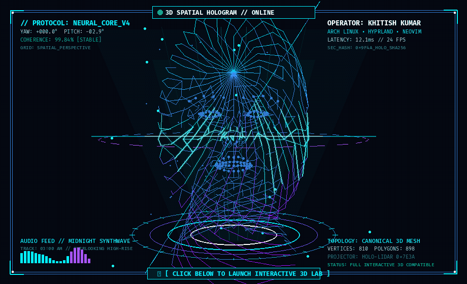
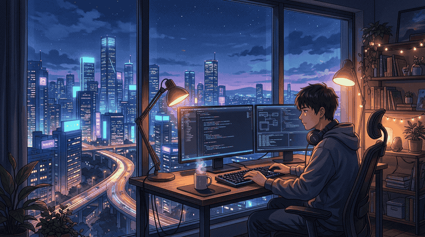
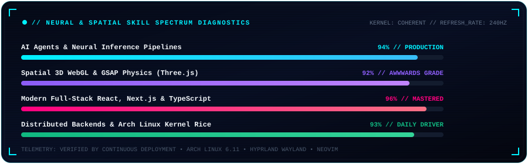

<div align="center">

<!-- ═══════════════════════════════════════════════════════════════════════════ -->
<!-- ⚡ SCENE 00: AWWWARDS-TIER HOLOGRAPHIC HUD HEADER -->
<!-- ═══════════════════════════════════════════════════════════════════════════ -->

<a href="https://khitishkumar.vercel.app/" target="_blank">
  
</a>

<br><br>

<!-- ⚡ DYNAMIC NEON TYPING REEL -->
<a href="https://khitishkumar.vercel.app/" target="_blank">
  
</a>

<br><br>

<!-- 🟢 HOLOGRAPHIC TELEMETRY STATUS PILLS -->
<p align="center">
  <a href="https://github.com/Khitishnayak">
    
  </a>
  &nbsp;
  <a href="https://github.com/Khitishnayak?tab=followers">
    
  </a>
  &nbsp;
  <a href="https://khitishkumar.vercel.app/">
    
  </a>
  &nbsp;
  <a href="https://archlinux.org/">
    
  </a>
  &nbsp;
  <a href="mailto:kknayak049@gmail.com">
    
  </a>
</p>


</div>

<br>

<!-- ═══════════════════════════════════════════════════════════════════════════ -->
<!-- 🔮 SCENE 01: THE 3D MODEL HOLOGRAM PROJECTOR (HERO PIECE) -->
<!-- ═══════════════════════════════════════════════════════════════════════════ -->

<div align="center">

### 🔮 Scene 01 // The 3D Spatial Hologram Projector
<sub><i>Real canonical 3D facial topology &amp; quantum orbital gimbal projection • Rendered in real-time</i></sub>

<br><br>

<!-- 3D HOLOGRAM ANIMATED PROJECTOR -->
<a href="https://khitishnayak.github.io/Khitishnayak/" target="_blank">
  
</a>

<br><br>

<!-- INTERACTIVE 3D WEBGL LAB CTA BUTTON -->
<a href="https://khitishnayak.github.io/Khitishnayak/" target="_blank">
  
</a>

<p align="center">
  <sub>👆 <b>Click to launch the live interactive WebGL experience:</b> Rotate 3D models with mouse, switch quantum cores, trigger glitch shaders &amp; synthesize sci-fi audio!</sub>
</p>

<br>


</div>

<br>

<!-- ═══════════════════════════════════════════════════════════════════════════ -->
<!-- 🌆 SCENE 02: HIGH-RISE LIVE CONSOLE & SCENERY -->
<!-- ═══════════════════════════════════════════════════════════════════════════ -->

<div align="center">

### 🌆 Scene 02 // Station Zero (The High-Rise Late Night Lab)

<a href="https://khitishkumar.vercel.app/" target="_blank">
  
</a>

<br><br>

<!-- 🎧 LIVE AUDIO EQUALIZER HUD -->
<p align="center">
  
  <br>
  <code>▶ 03:14 ━━━━━━━━━━━━━━━━━━━━●────── 04:20 &nbsp; ⇄ &nbsp; ◃◃ &nbsp; ⅠⅠ &nbsp; ▹▹ &nbsp; ↻ &nbsp; 🔊 88%</code>
  <br>
  <sub>🎧 <b>Audio Telemetry:</b> <i>Midnight Synthwave // 42nd Floor Studio Overlooking The Neon Horizon</i></sub>
</p>

<br>

<!-- ANIMATED TERMINAL WINDOW -->


<br><br>

```text
╭──────────────────────────────────────────────────────────────────────────────╮
│  STATION ZERO // 42ND FLOOR OVERLOOKING SILICON HORIZON                      │
├──────────────────────────────────────────────────────────────────────────────┤
│  🌃 SCENERY     │ Floor-to-ceiling glass window, cyber night, highway trails │
│  👨‍💻 OPERATOR    │ Khitish Kumar Nayak (AI Engineer & Full-Stack Architect)    │
│  ☕ FUEL        │ Steaming dark roast pour-over & relentless obsession       │
│  🐧 WORKSPACE   │ Arch Linux (Rolling) • Hyprland • Neovim • Alacritty       │
│  🧠 DOMAINS     │ Autonomous Multi-Agent AI • Spatial 3D WebGL • Distributed │
│  🏛️ ACADEMY     │ Lovely Professional University (LPU)                       │
│  📍 COORDINATES │ 31.3260° N, 75.5762° E // Jalandhar, Punjab, India         │
│  🌐 PORTFOLIO   │ https://khitishkumar.vercel.app                            │
│  📫 TRANSMIT    │ kknayak049@gmail.com                                       │
│  ✨ CREED       │ "Software shouldn't just work — it should feel alive."     │
╰──────────────────────────────────────────────────────────────────────────────╯
```


</div>

<br>

<!-- ═══════════════════════════════════════════════════════════════════════════ -->
<!-- ⚡ SCENE 03: CORE ENGINEERING PILLARS -->
<!-- ═══════════════════════════════════════════════════════════════════════════ -->

### ⚡ Scene 03 // Core Engineering Pillars

- 🧠 **Autonomous Multi-Agent AI**: Architecting cooperative multi-agent swarms, self-healing tool-calling routines, and low-latency neural inference pipelines.
- 🎨 **Spatial 3D & Creative Web**: Engineering physics-based web experiences using **Three.js**, custom GLSL vertex/fragment shaders, and silky **GSAP** timelines.
- ⚡ **Zero-to-One Startup Velocity**: Turning complex abstract ideas into production-ready software with obsession over micro-interactions and haptic feel.
- 🐧 **Systems & Kernel Craft**: Daily driving an extensively tuned **Arch Linux** environment powered by **Hyprland** (Wayland) and **Neovim** keyboard-centric workflows.
- 🤝 **Audacious Collaboration**: Partnering with founders, researchers, and creators to build what doesn't yet exist.

<div align="center">
  
</div>

<br>

<!-- ═══════════════════════════════════════════════════════════════════════════ -->
<!-- 🛠️ SCENE 04: THE WORKBENCH (TOOLS OF CREATION) -->
<!-- ═══════════════════════════════════════════════════════════════════════════ -->

<div align="center">

### 🛠️ Scene 04 // The Workbench (Tools of Creation)

#### 🧠 Neural Architectures & Artificial Intelligence
<p align="center">
  <a href="https://skillicons.dev">
    
  </a>
</p>

#### 🎨 Creative Web, Spatial 3D & Interface Engineering
<p align="center">
  <a href="https://skillicons.dev">
    
  </a>
</p>

#### 🗄️ Distributed Backends, Databases & Cloud
<p align="center">
  <a href="https://skillicons.dev">
    
  </a>
</p>

#### 🐧 Systems Engineering & Cockpit
<p align="center">
  <a href="https://skillicons.dev">
    
  </a>
</p>


</div>

<br>

<!-- ═══════════════════════════════════════════════════════════════════════════ -->
<!-- 🎞️ SCENE 05: FEATURED WORKS (FILMOGRAPHY) -->
<!-- ═══════════════════════════════════════════════════════════════════════════ -->

<div align="center">

### 🎞️ Scene 05 // The Featured Works (Filmography)

| Project Reel | Scenario & Architecture | Stack | Reel Link |
| :--- | :--- | :--- | :---: |
| 🔮 **[3D Hologram Lab](https://khitishnayak.github.io/Khitishnayak/)** | Awwwards-tier interactive spatial 3D WebGL laboratory featuring rotating canonical head topology, quantum cores, and audio synth. | `Three.js` `WebGL` `GLSL` `Web Audio` | [**Launch Lab ↗**](https://khitishnayak.github.io/Khitishnayak/) |
| 🌐 **[3D Portfolio](https://github.com/Khitishnayak/3D-PORTFOLIO)** | Spatial WebGL developer portfolio featuring dynamic three-dimensional lighting, shaders, and interactive nodes. | `Three.js` `WebGL` `React` | [**Roll Film ↗**](https://github.com/Khitishnayak/3D-PORTFOLIO) |
| ⚡ **[SPYLT](https://github.com/Khitishnayak/Splyt-Gsap)** | Awwwards-caliber interactive web showcase boasting silky micro-interactions &amp; physics-based GSAP transitions. | `JavaScript` `GSAP` `CSS3` | [**Roll Film ↗**](https://github.com/Khitishnayak/Splyt-Gsap) |
| 🧠 **[Medhamind](https://github.com/Khitishnayak/Medhamind)** | AI-powered mental health companion featuring conversational intelligence &amp; emotional sentiment tracking. | `Python` `NLP` `FastAPI` `React` | [**Roll Film ↗**](https://github.com/Khitishnayak/Medhamind) |
| 🎨 **[FloatPen](https://github.com/Khitishnayak/floatpen)** | Ultra-responsive, frictionless canvas drawing &amp; screen annotation platform engineered for thinkers and creators. | `TypeScript` `Canvas API` `Tailwind` | [**Roll Film ↗**](https://github.com/Khitishnayak/floatpen) |
| 🧺 **[Uber For Laundry](https://github.com/Khitishnayak/UBER-FOR-LAUNDRY)** | On-demand service logistics platform orchestrating real-time dispatch, customer booking &amp; lifecycle management. | `React` `Node.js` `Express` `MongoDB` | [**Roll Film ↗**](https://github.com/Khitishnayak/UBER-FOR-LAUNDRY) |
| ✈️ **[TravelWise](https://github.com/Khitishnayak/Travelwise1)** | Intelligent travel itinerary architect and dynamic destination exploration engine. | `React` `REST APIs` `Tailwind` | [**Roll Film ↗**](https://github.com/Khitishnayak/Travelwise1) |

<br>


</div>

<br>

<!-- ═══════════════════════════════════════════════════════════════════════════ -->
<!-- 📊 SCENE 06: TELEMETRY & ACTIVITY MATRIX -->
<!-- ═══════════════════════════════════════════════════════════════════════════ -->

<div align="center">

### 📊 Scene 06 // Telemetry & Activity Matrix

<!-- HOLOGRAPHIC SKILL SPECTRUM DIAGNOSTICS CARD -->


<br><br>

<!-- GITHUB STATS & LANGUAGES -->
<a href="https://github.com/Khitishnayak">
  
</a>
<a href="https://github.com/Khitishnayak">
  
</a>

<br><br>

<!-- GITHUB STREAK STATS -->
<a href="https://github.com/Khitishnayak">
  
</a>

<br><br>

<!-- 🐍 MIDNIGHT MATRIX CONTRIBUTION STREAM SNAKE -->
#### 🐍 Midnight Matrix // Animated Contribution Stream

<picture>
  <source media="(prefers-color-scheme: dark)" srcset="https://raw.githubusercontent.com/Khitishnayak/Khitishnayak/output/github-contribution-grid-snake-dark.svg">
  <source media="(prefers-color-scheme: light)" srcset="https://raw.githubusercontent.com/Khitishnayak/Khitishnayak/output/github-contribution-grid-snake.svg">
  
</picture>

<br><br>


</div>

<br>

<!-- ═══════════════════════════════════════════════════════════════════════════ -->
<!-- 📻 SCENE 07: END CREDITS & UPLINK (CONNECT) -->
<!-- ═══════════════════════════════════════════════════════════════════════════ -->

<div align="center">

### 📻 Scene 07 // End Credits &amp; Uplink (Connect)

<p>
  <i>"We are the architects of the silent hours, building the software that greets the morning sun."</i>
</p>

<p align="center">
  <a href="https://khitishkumar.vercel.app/" target="_blank">
    
  </a>
  &nbsp;
  <a href="https://www.linkedin.com/in/khitish-kumar-nayak-594051285/" target="_blank">
    
  </a>
  &nbsp;
  <a href="https://x.com/khitishkumarn12" target="_blank">
    
  </a>
  &nbsp;
  <a href="https://instagram.com/alexian_era" target="_blank">
    
  </a>
  &nbsp;
  <a href="mailto:kknayak049@gmail.com">
    
  </a>
  &nbsp;
  <a href="https://www.buymeacoffee.com/alexian_era" target="_blank">
    
  </a>
</p>

<br>

<!-- 🌊 ANIMATED WAVING CAPSULE FOOTER -->


<br>

**`</>` Produced & Directed with ⚡ by Khitish Kumar**<br>
<sub>Arch Linux • Hyprland • Neovim • 2026</sub>

</div>
